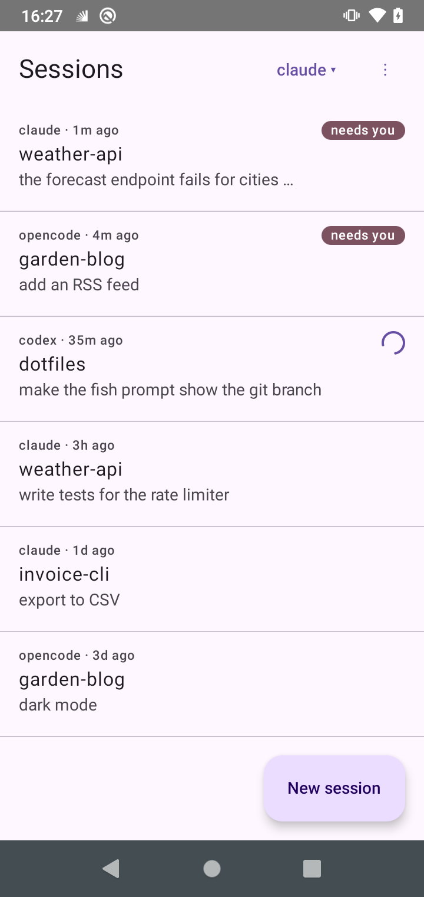
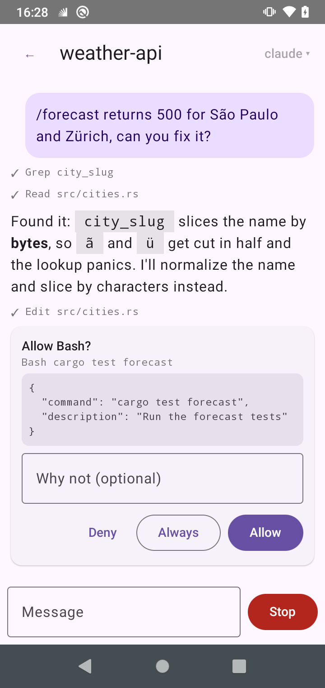
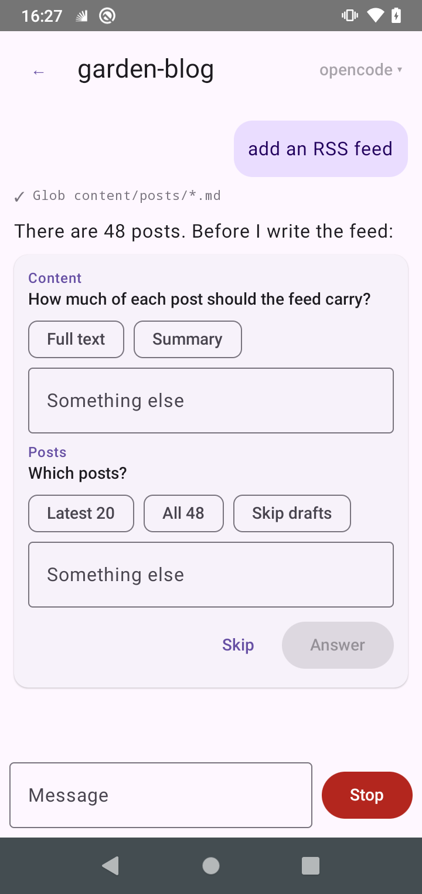
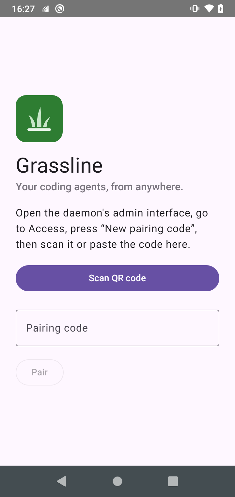
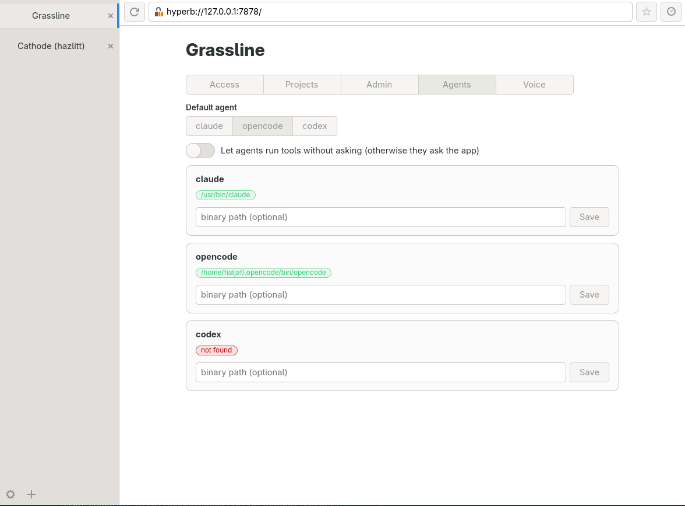
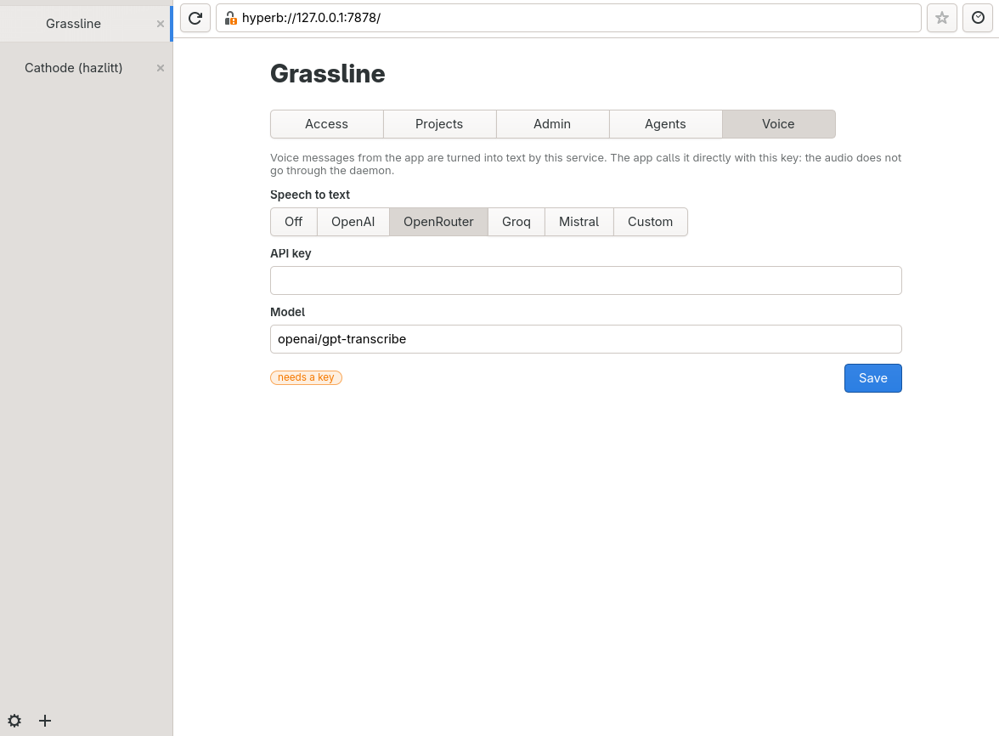

<p align="center">
  
</p>

<h1 align="center">Grassline</h1>

<p align="center">A calm framework for controlling agents from afar.</p>

Grassline runs Claude Code, opencode, Codex and others on your own computer and lets you talk to them from your phone.

Grassline has no notifications, no file browser or command line and doesn't try to replicate your desktop workstation in your phone, only a chat interface for when you're on the go.

Voice commands are supported as long as you bring your own API keys.

Communication between phone and computer computer happens over [iroh](https://iroh.computer), so it is encrypted and works and no servers are needed.

You don't have to manually configure each project you already have in Grassline, because projects are just directories, and if you setup a base directory on Grassline all directories under it are automatically assumed to be projects.

The daemon that you run on your computer is pure Rust with no UI, it uses almost no memory and CPU, so you can keep it running always in the background.

<p align="center">
  
  
  
  
</p>

## The admin dashboard

The daemon on your computer is headless, but it can be configured from a dashboard you open in a [hyperb](https://github.com/andunieee/hyperb) browser. There you can pair phones and see who's connected, choose which directories are projects, check which agents are installed, and set up voice messages.

<p align="center">
  
  
</p>

## Getting started

Grassline has two parts: the `grasslined` daemon, which runs on the computer where your agents
live, and the Android app. Both are attached to every
[GitHub release](https://github.com/andunieee/grassline/releases/latest):

- `.deb` for Debian, Ubuntu and derivatives
- `.rpm` for Fedora, openSUSE and derivatives
- `.pkg.tar.zst` for Arch Linux
- a `.tar.gz` with a single binary, for everything else (Linux x86_64 and aarch64, macOS)
- the `.apk` for the phone

The daemon is meant to run as a systemd user service, with the unit in
[`deploy/grasslined.service`](deploy/grasslined.service). The packages and the tarball ship it.

Once the daemon is running, install the app on your phone, open the admin panel and pair them.

## Daemon

Each snippet installs the latest release and starts the daemon as a user service.

<details>
<summary>Debian / Ubuntu (.deb)</summary>

```bash
v=$(curl -fsSL https://api.github.com/repos/andunieee/grassline/releases/latest | grep -Po '"tag_name": *"v\K[^"]+')
curl -fLO "https://github.com/andunieee/grassline/releases/download/v$v/grasslined_${v}_$(dpkg --print-architecture).deb"
sudo apt install "./grasslined_${v}_$(dpkg --print-architecture).deb"
systemctl --user enable --now grasslined
```

</details>

<details>
<summary>Fedora / openSUSE (.rpm)</summary>

```bash
v=$(curl -fsSL https://api.github.com/repos/andunieee/grassline/releases/latest | grep -Po '"tag_name": *"v\K[^"]+')
sudo dnf install "https://github.com/andunieee/grassline/releases/download/v$v/grasslined-$v-1.$(uname -m).rpm"
systemctl --user enable --now grasslined
```

</details>

<details>
<summary>Arch Linux (.pkg.tar.zst)</summary>

```bash
v=$(curl -fsSL https://api.github.com/repos/andunieee/grassline/releases/latest | grep -Po '"tag_name": *"v\K[^"]+')
sudo pacman -U "https://github.com/andunieee/grassline/releases/download/v$v/grasslined-$v-1-$(uname -m).pkg.tar.zst"
systemctl --user enable --now grasslined
```

</details>

<details>
<summary>Single binary (any Linux with systemd)</summary>

```bash
v=$(curl -fsSL https://api.github.com/repos/andunieee/grassline/releases/latest | grep -Po '"tag_name": *"v\K[^"]+')
name="grasslined-$v-$(uname -m)-unknown-linux-gnu"
curl -fL "https://github.com/andunieee/grassline/releases/download/v$v/$name.tar.gz" | tar -xz
install -Dm755 "$name/grasslined" ~/.local/bin/grasslined
sed 's|^ExecStart=.*|ExecStart=%h/.local/bin/grasslined|' "$name/grasslined.service" \
  | install -Dm644 /dev/stdin ~/.config/systemd/user/grasslined.service
rm -rf "$name"
systemctl --user daemon-reload
systemctl --user enable --now grasslined
```

</details>

<details>
<summary>From source</summary>

```bash
git clone https://github.com/andunieee/grassline
cd grassline
just daemon-install
```

</details>

Check that it is running with `systemctl --user status grasslined`, and follow its logs with
`journalctl --user -u grasslined -f`. To keep it running while you are logged out, run
`sudo loginctl enable-linger $USER`.

## App

Download the latest
[`grassline-<version>.apk`](https://github.com/andunieee/grassline/releases/latest) from the
releases page on your phone and open it to install (Android will ask you to allow installs from
your browser). To build it yourself and install it on phones connected through adb, run
`just android`.

## Admin panel

The admin panel is served by the daemon and is opened with [hyperb](https://github.com/andunieee/hyperb).
With hyperb installed, open `hyperb://127.0.0.1:7878/`, go to **Access**, press
**New pairing code**, and scan it with the app. Then add your projects under **Projects** and
start a session from the phone.

## Releases

Pushing a tag builds and publishes everything:

```
git tag v0.1.0
git push origin v0.1.0
```

The release workflow builds `grasslined` for Linux (x86_64 and aarch64) and macOS (Apple
Silicon and Intel), packages each with the systemd unit and this README, and builds the
release APK. All of it is attached to the GitHub release for the tag.

The APK is signed with the debug key unless these repository secrets are set:
`ANDROID_KEYSTORE_BASE64` (the base64 of a `.jks` file), `ANDROID_KEYSTORE_PASSWORD`,
`ANDROID_KEY_ALIAS` and `ANDROID_KEY_PASSWORD`. Builds signed with different keys cannot
be installed over each other, so keep the same keystore for every release.
